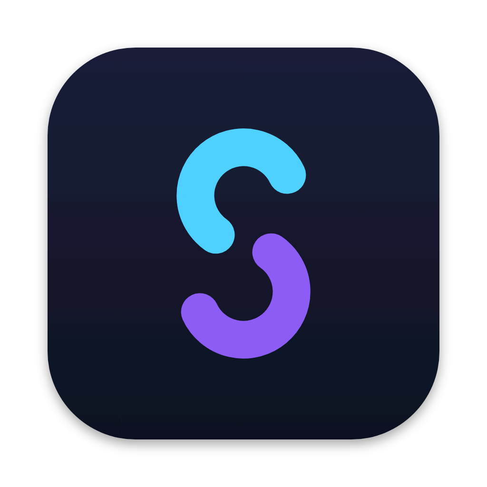

<p align="center"></p>

# Sawaruna

**AIに作業を続けさせたまま、人が触った瞬間に Mac や Windows パソコンをロックします。**

ダウンロード：[sawaruna.com](https://sawaruna.com/ja/)。このページは Mac 版の説明です。Windows 版（ベータ）は [windows/README.md](windows/README.md) をご覧ください。

[English](README.md)

AIエージェントにMacを任せて席を離れるとき、AIが作業を続けられるように画面はロックできません。でもそのままだと、通りかかった人がだれでも触れてしまいます。Sawaruna はマウスとキーボードを見張ります。AIなどのソフトが送る操作は無視し、人が実際にマウスやキーボードに触った瞬間にMacをロックします。

## 使い方

1. **control + option + L** を押すか、画面右上（メニューバー）の盾のアイコンを押して「見張りを始める」を選びます。
2. 3秒間、手を離します。「チン」と鳴ったら見張りが始まります。
3. だれかがマウスやキーボードに触ると、すぐにロックされます。解除はいつものパスワードやTouch IDです。

人の操作とソフトの操作は、「どのプログラムが送った操作か」で見分けます。実際のマウスやキーボードからの操作はシステム（プロセスID 0）から届き、アプリが作った操作はそのアプリから届きます。また、パスワードの入力欄が開いている間は macOS がキー入力をほかのアプリに見せないため、キーボード本体からの入力も直接受け取っています。こちらも「キーボードのキーが押されたか」だけを確かめ、どのキーかは使いません。

触られた瞬間にMacのカメラで写真を3枚撮ることもできます（最初はオフです）。

## 動作環境

- macOS 13 Ventura 以降（Apple シリコン、Intel）
- ソースから作る場合は Xcode Command Line Tools

## インストール（ソースから作る）

```sh
git clone https://github.com/yoshn/sawaruna.git
cd sawaruna
zsh install.command
```

インストーラーがあなたのMacの上でアプリを作り、`~/Applications/Sawaruna.app` に入れて開きます。画面の案内に沿って「入力監視」を許可してください。署名・公証済みのアプリは [sawaruna.com](https://sawaruna.com/ja/) からもダウンロードできます。

削除するときは `zsh uninstall.command` を実行します。Sawaruna が撮った写真は「ピクチャ/Sawaruna」に残ります。

## うまくいかないとき

**「入力監視」をオンにしたのに、許可されていないと表示される。** 以前の Sawaruna（ソースから作ったものなど）の登録が一覧に残っていると起きます。Sawaruna を終了してから次のコマンドを実行し、Sawaruna を開き直して、新しく出た項目をオンにしてください。

```sh
tccutil reset ListenEvent com.sawaruna.app
```

## プライバシー

- インターネットに接続しません。ソースに通信のコードはありません。
- 押したキーがどれかは使わず、記録もしません。使うのは「触られた」という事実だけです。
- 入力を見るのは、見張りを始めてから（手を離して待つ3秒を含みます）ロックするまでだけです。
- 写真（オンにした場合）は、このMacの中にだけ保存します。

詳しくは [PRIVACY.md](PRIVACY.md) と [SECURITY.ja.md](SECURITY.ja.md) を見てください。Sawaruna で防げないことも書いています。

## Windows 版（ベータ）

Windows 10・11 版をベータ版として公開しています。[windows/README.md](windows/README.md) と [リリース](https://github.com/yoshn/sawaruna/releases) をご覧ください。

## 対応言語

25言語です：日本語、英語、韓国語、中国語（簡体字・繁体字）、スペイン語、フランス語、ドイツ語、ポルトガル語、イタリア語、ロシア語、ヒンディー語、インドネシア語、トルコ語、オランダ語、ポーランド語、ベトナム語、タイ語、スウェーデン語、ウクライナ語、デンマーク語、ノルウェー語、フィンランド語、アイスランド語、ヘブライ語。ヘブライ語は右から左の表示に対応しています。

## コード署名のルール

- **Mac 版：** Apple の Developer ID 証明書で署名し、Apple の公証を受けています。このリポジトリのソースから [release.command](release.command) で作っています。
- **Windows 版：** このリポジトリのソースから [GitHub Actions](.github/workflows/windows.yml) だけで作ります。いまはまだ署名がありません。オープンソース向けの無料の署名制度（[SignPath Foundation](https://signpath.org)）で署名する予定です。
- **役割：** コミットとレビュー：[中村ヨシキ](https://github.com/yoshn)。署名の承認：[中村ヨシキ](https://github.com/yoshn)。
- 署名の依頼は、毎回承認者が手で承認します。ソースを変更できるアカウントと署名を承認できるアカウントは、多要素認証を使います。
- **プライバシー：** Sawaruna はどんな情報もほかのネットワーク上のシステムに送りません。[PRIVACY.md](PRIVACY.md) をご覧ください。

## ライセンス

Sawaruna は [GNU General Public License バージョン3（またはそれ以降の任意のバージョン）](LICENSE) のもとで、使う・配る・改造することができるフリーソフトウェアです。配布するときは（改造の有無にかかわらず）、受け取った人にソースコード一式を同じライセンスで提供する必要があります。

無保証です。Sawaruna は便利な道具であって、安全を保証するものではありません。本当に大事なものを守る場面では、control + command + Q でMacをロックしてください。

「Sawaruna」の名前とロゴは中村圭希（Yoshiki Nakamura）の商標です。ライセンスは、名前とロゴを商標として使う権利を含みません。詳しくは [TRADEMARKS.md](TRADEMARKS.md) を見てください。
